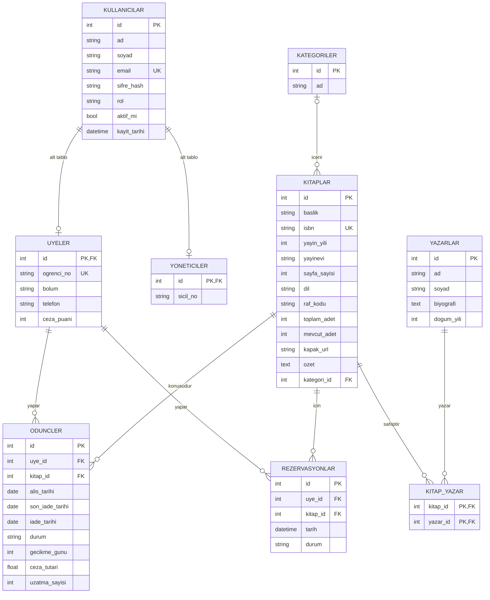
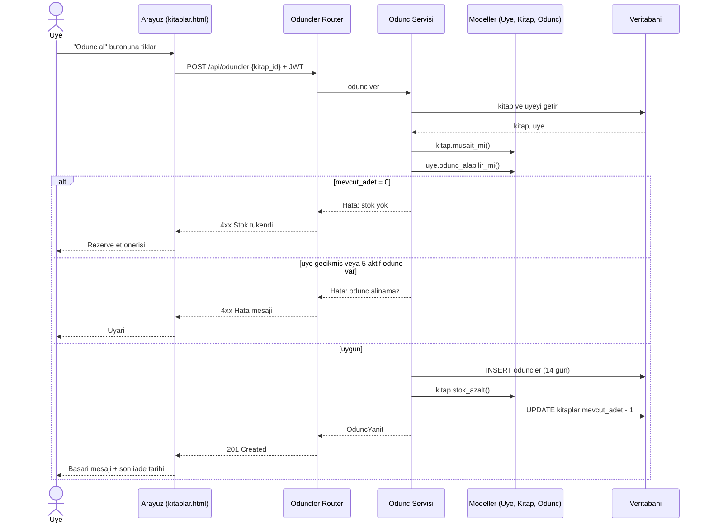

# 📚 Online Kütüphane Yönetim Sistemi

Üniversite öğrencilerinin kitap arayıp **ödünç alabildiği, uzatabildiği, iade edebildiği ve tükenen kitaplar için rezervasyon yapabildiği**; yöneticilerin ise kitap, yazar, kategori ve üyeleri yönetip **gecikme ve stok raporlarını** takip edebildiği tam kapsamlı bir kütüphane otomasyonudur.

Sistem; çalışan bir web arayüzü, REST API'si (Swagger belgeli), veritabanı, otomatik testler ve UML diyagramlarıyla birlikte gelir.

## İçindekiler

- [Özellikler](#özellikler)
- [Kullanılan teknolojiler](#kullanılan-teknolojiler)
- [Mimari](#mimari)
- [Kurulum ve çalıştırma](#kurulum-ve-çalıştırma)
- [Demo hesaplar](#demo-hesaplar)
- [İş kuralları](#iş-kuralları)
- [API uçları](#api-uçları)
- [Proje yapısı](#proje-yapısı)
- [UML diyagramları](#uml-diyagramları)
- [Testler](#testler)
- [Geliştirme notu](#geliştirme-notu)

## Özellikler

### Üye
- Kayıt olma ve giriş yapma
- Kitap arama (başlık, yazar, ISBN), kategori filtresi, müsaitlik rozeti
- Kitap detay sayfası
- Kitap **ödünç alma**, süre **uzatma**, **iade etme**
- Tükenen kitaplar için **rezervasyon** (sıra numarasıyla) ve iptal
- Kendi ödünçlerini, kalan günleri, gecikmeleri ve cezalarını görme

### Yönetici
- **Kitap**, **yazar**, **kategori** ve **üye** için ekleme, düzenleme, silme (CRUD)
- Üyeyi aktif / pasif yapma
- Üye adına ödünç verme ve iade alma
- Raporlar: geciken ödünçler, az kalan stok, en çok okunan kitaplar, genel özet (dashboard)

## Kullanılan teknolojiler

| Katman | Teknoloji |
|---|---|
| Arka uç | Python 3.11+, **FastAPI**, Uvicorn |
| Veritabanı | **SQLite** (geliştirme), SQLAlchemy 2.x ORM. Canlı ortam için PostgreSQL'e geçiş uygundur. |
| Doğrulama | Pydantic v2 |
| Güvenlik | **JWT** (python-jose), bcrypt ile şifre hash (passlib), rol tabanlı yetkilendirme |
| Arayüz | HTML, CSS, JavaScript, Tailwind CSS (derleme adımı gerektirmez) |
| API belgesi | Swagger UI (`/docs`) |
| Test | pytest |

## Mimari

**Katmanlı mimari** kullanılmıştır. Bağımlılık yönü yukarıdan aşağıdır:

```
Arayüz (static)  →  Routers (API)  →  Services (iş mantığı)  →  Repositories (veri erişim)  →  Models  →  Veritabanı
```

Gerçek ortam dağıtımı: `Tarayıcı → Web sunucusu (Nginx) → API sunucusu (FastAPI/Uvicorn) → Veritabanı (PostgreSQL)`

## Kurulum ve çalıştırma

**Gereksinim:** Python 3.11 veya üstü.

```bash
# 1. Projeyi indir
git clone <REPO-ADRESI>
cd <KLASOR-ADI>

# 2. Sanal ortam oluştur ve etkinleştir (Windows)
python -m venv .venv
.venv\Scripts\activate
# macOS / Linux: source .venv/bin/activate

# 3. Bağımlılıkları kur
pip install -r requirements.txt

# 4. Uygulamayı başlat
uvicorn app.main:app --reload
```

Ardından tarayıcıda aç:

| Adres | Açıklama |
|---|---|
| http://127.0.0.1:8000 | Web arayüzü |
| http://127.0.0.1:8000/docs | Swagger (API belgesi) |

İlk çalıştırmada veritabanı (`kutuphane.db`) otomatik oluşturulur ve örnek verilerle (kitap, yazar, kategori, üye, ödünç kayıtları) dolar.

## Demo hesaplar

| Rol | E-posta | Şifre |
|---|---|---|
| Yönetici | admin@kutuphane.com | Admin123! |
| Üye | ahmet@ogr.edu.tr | Uye123! |
| Üye (gecikmiş kitabı var) | ayse@ogr.edu.tr | Uye123! |

## İş kuralları

- Ödünç süresi **14 gün**; üye **1 kez 7 gün** uzatabilir.
- Bir üye aynı anda en fazla **5 aktif ödünç** alabilir.
- **Gecikmiş kitabı olan üye** yeni ödünç alamaz.
- **Stok 0** ise ödünç verilmez; rezervasyon yapılır.
- Aynı kitap aynı üyeye aktif olarak iki kez verilmez.
- Gecikme cezası **günlük 2 TL**; iade sırasında hesaplanır.
- İade edilince stok artar ve bekleyen ilk rezervasyon karşılanır.
- Aktif ödüncü olan kitap ve kitabı olan yazar silinemez.
- Üye yalnızca kendi verisini görür; yönetici her şeyi yapar.

## API uçları

Tüm uçlar `/api` altındadır. Ayrıntılı şema için Swagger: `/docs`

| Grup | Uçlar |
|---|---|
| **Kimlik** | `POST /auth/kayit`, `POST /auth/giris`, `POST /auth/token`, `GET /auth/ben` |
| **Kitaplar** | `GET /kitaplar` (arama, sayfalama, sıralama), `GET /kitaplar/{id}`, `POST`, `PUT /{id}`, `DELETE /{id}` |
| **Yazarlar** | `GET /yazarlar`, `GET /{id}`, `POST`, `PUT /{id}`, `DELETE /{id}` |
| **Kategoriler** | `GET /kategoriler`, `GET /{id}`, `POST`, `PUT /{id}`, `DELETE /{id}` |
| **Üyeler** | `GET /uyeler`, `GET /{id}`, `PUT /{id}`, `PUT /{id}/aktiflik`, `DELETE /{id}` |
| **Ödünç** | `POST /oduncler`, `GET /oduncler`, `GET /oduncler/benim`, `PUT /oduncler/{id}/iade`, `PUT /oduncler/{id}/uzat` |
| **Rezervasyon** | `POST /rezervasyonlar`, `GET /rezervasyonlar`, `GET /rezervasyonlar/benim`, `DELETE /rezervasyonlar/{id}` |
| **Raporlar** | `GET /raporlar/gecikmeler`, `/raporlar/stok`, `/raporlar/en-cok-okunanlar`, `/raporlar/ozet` |

## Proje yapısı

```
.
├── app/
│   ├── main.py            # Uygulama girişi
│   ├── models/            # SQLAlchemy domain sınıfları
│   ├── schemas/           # Pydantic istek/yanıt modelleri
│   ├── repositories/      # Veri erişim katmanı
│   ├── services/          # İş mantığı
│   ├── routers/           # API uçları
│   ├── core/              # Ayarlar, güvenlik, bağımlılıklar
│   └── static/            # Web arayüzü (HTML, CSS, JS)
├── docs/                  # UML diyagramları (.mmd, .puml)
├── tests/                 # pytest testleri
├── requirements.txt
└── README.md
```

## UML diyagramları

Diyagram kaynak dosyaları `docs/` klasöründedir. Mermaid diyagramları aşağıda GitHub'da otomatik çizilir. PlantUML dosyaları (`.puml`) için https://www.plantuml.com/plantuml adresine yapıştırılabilir.

| Diyagram | Dosya |
|---|---|
| Class Diagram | `docs/class_diagram.mmd` |
| Object Diagram | `docs/object_diagram.puml` |
| Package Diagram | `docs/package_diagram.puml` |
| Deployment Diagram | `docs/deployment_diagram.puml` |
| ER Diagram | `docs/er_diagram.mmd` |
| Use Case Diagram | `docs/use_case.puml` |
| Sequence Diagram | `docs/sequence_odunc.mmd` |

### Class Diagram

```mermaid
classDiagram
    direction TB
    class Kullanici {
        -int id
        -String ad
        -String soyad
        -String email
        -String sifre_hash
        -String rol
        -bool aktif_mi
        -DateTime kayit_tarihi
        +yonetici_mi() bool
    }
    class Uye {
        -String ogrenci_no
        -String bolum
        -String telefon
        -int ceza_puani
        +aktif_oduncler() List~Odunc~
        +aktif_odunc_sayisi() int
        +gecikmis_odunc_var_mi() bool
        +odunc_alabilir_mi() bool
        +bekleyen_rezervasyonlar() List~Rezervasyon~
        +toplam_ceza() float
    }
    class Yonetici {
        -String sicil_no
    }
    class Kitap {
        -int id
        -String baslik
        -String isbn
        -int yayin_yili
        -String yayinevi
        -int sayfa_sayisi
        -String dil
        -String raf_kodu
        -int toplam_adet
        -int mevcut_adet
        -String kapak_url
        -String ozet
        +musait_mi() bool
        +stok_azalt()
        +stok_artir()
        +aktif_odunc_var_mi() bool
        +siradaki_rezervasyon() Rezervasyon
    }
    class Yazar {
        -int id
        -String ad
        -String soyad
        -String biyografi
        -int dogum_yili
        +kitabi_var_mi() bool
    }
    class Kategori {
        -int id
        -String ad
        +kitap_sayisi() int
    }
    class Odunc {
        -int id
        -Date alis_tarihi
        -Date son_iade_tarihi
        -Date iade_tarihi
        -String durum
        -int gecikme_gunu
        -float ceza_tutari
        -int uzatma_sayisi
        +iade_edildi_mi() bool
        +gecikme_gunu_hesapla() int
        +ceza_hesapla() float
        +gecikmis_mi() bool
        +kalan_gun() int
        +durumu_guncelle()
        +uzat()
        +iade_et()
    }
    class Rezervasyon {
        -int id
        -DateTime tarih
        -String durum
        +bekliyor_mu() bool
        +karsila()
        +iptal_et()
    }
    Kullanici <|-- Uye
    Kullanici <|-- Yonetici
    Uye "1" --> "0..*" Odunc : yapar
    Kitap "1" --> "0..*" Odunc : konusudur
    Uye "1" --> "0..*" Rezervasyon : yapar
    Kitap "1" --> "0..*" Rezervasyon : icin
    Kategori "0..1" o-- "0..*" Kitap : icerir
    Yazar "0..*" -- "0..*" Kitap : yazar
```



### ER Diagram (veritabanı)



### Sequence Diagram (ödünç alma akışı)



## Testler

```bash
python -m pytest
```

Testler giriş, rol kontrolü, ödünç alma ve iade (stok değişimi), aynı kitabın iki kez alınamaması, stok sıfırken ödünç verilmemesi, gecikmiş üyenin yeni ödünç alamaması ve gecikme raporunu kontrol eder. Testler demo veritabanı üzerinde çalışır.

## Geliştirme notu

Proje bir üniversite dersi (UML ve yazılım tasarımı) uygulaması olarak hazırlanmıştır. Geliştirme sürecinde yapay zekâ destekli kodlama aracı **Antigravity** kullanılmıştır.
